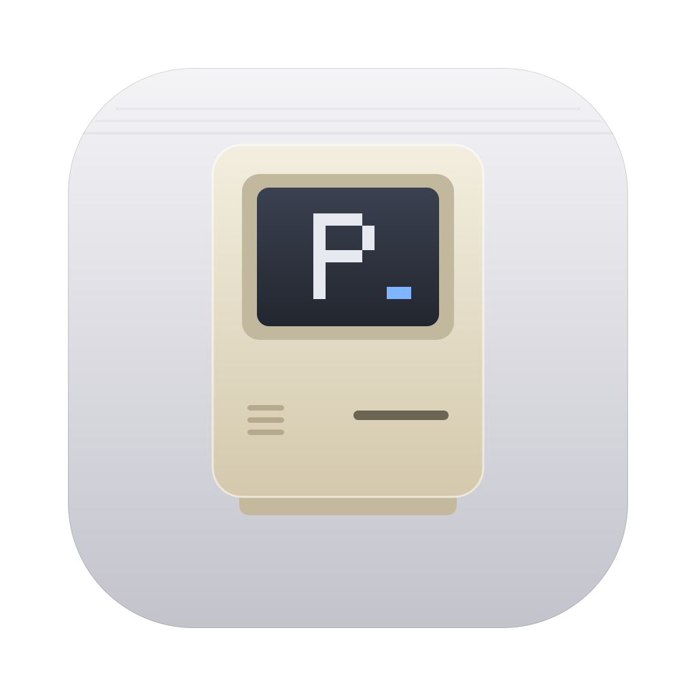
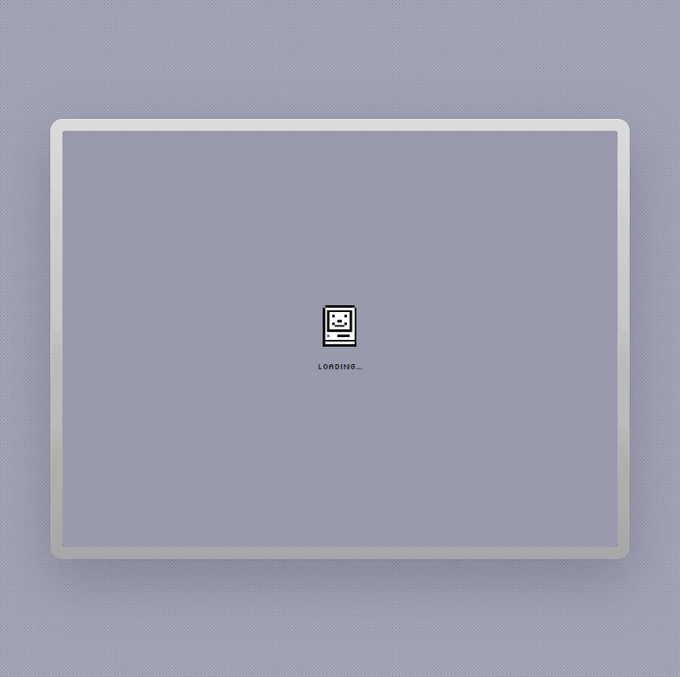
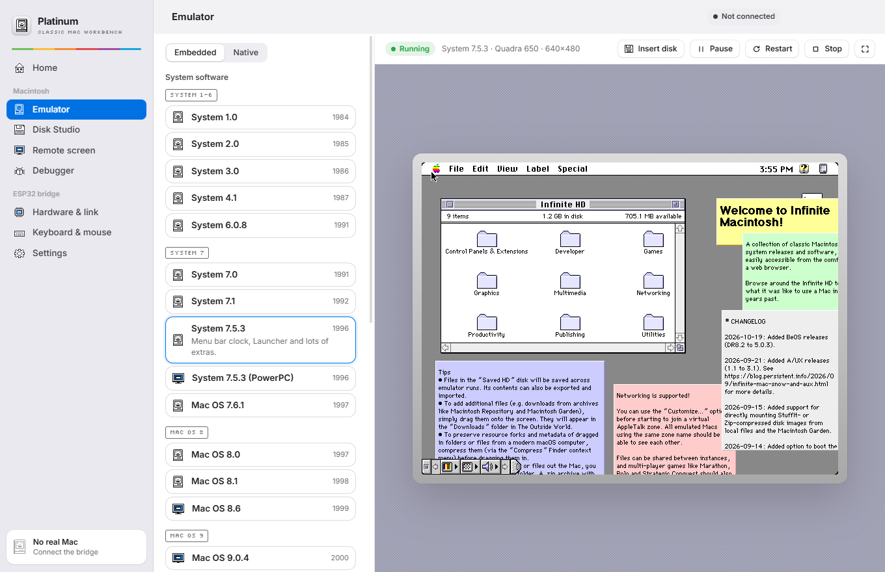
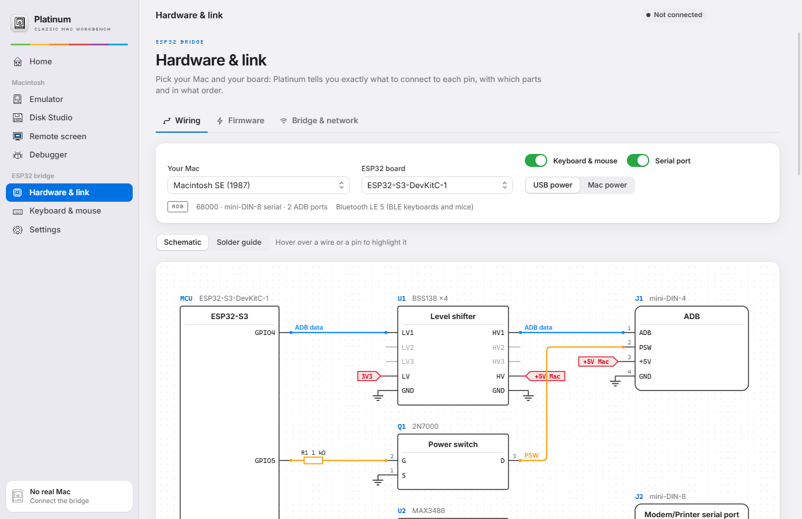
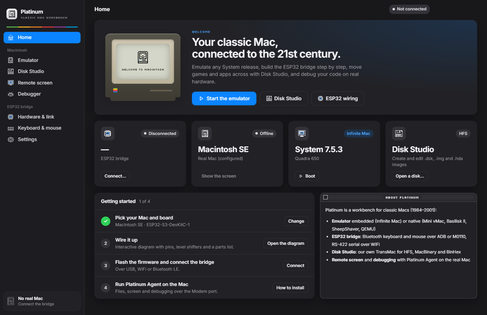
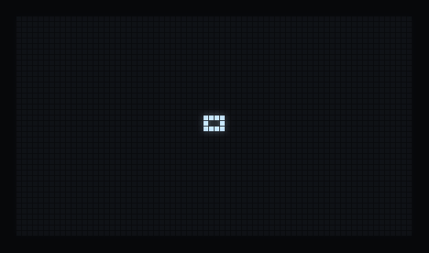

<p align="center">
  
</p>

<h1 align="center">Platinum</h1>

<p align="center"><b>Classic Mac workbench: emulate, bridge real hardware, move files, debug.</b></p>

<p align="center">
  <a href="https://github.com/Marcm2003/platinum/releases/latest"></a>
  <a href="https://github.com/Marcm2003/platinum/actions/workflows/ci.yml"></a>
  <a href="LICENSE"></a>
  
  
</p>

<p align="center">
  
</p>

Platinum is a desktop app for people who love the Macs of 1984–2001. One window gives you an emulator for every System release, a disk tool that speaks HFS, and everything you need to build a small ESP32 bridge for your real Mac: an interactive schematic, a solder guide, ready-made firmware and a status screen with a little Mac that tells you how things are.

<table>
  <tr>
    <td width="33%" valign="top"><b>🖥 Emulate</b><br>System 1.0 to Mac OS 9.2.2 in the app, or launch Mini vMac, Basilisk II, SheepShaver and QEMU.</td>
    <td width="33%" valign="top"><b>💾 Move files</b><br>Open, create and edit HFS disk images; drag files in and boot them straight away.</td>
    <td width="33%" valign="top"><b>🔌 Bridge real hardware</b><br>An ESP32 becomes your Mac's keyboard, mouse and wireless serial port.</td>
  </tr>
</table>

## Contents

- [Features](#features)
- [Download](#download)
- [Quick start](#quick-start)
- [The ESP32 bridge](#the-esp32-bridge)
- [Platinum Agent for the Mac](#platinum-agent-for-the-mac)
- [Status](#status)
- [Building from source](#building-from-source)
- [Contributing](#contributing)
- [Credits and licence](#credits-and-licence)

## Features

### Emulator

Boot anything from System 1.0 to Mac OS 9.2.2, plus Mac OS X 10.1, inside the app, powered by [Infinite Mac](https://infinitemac.org). Pick the machine, the screen size and the scale, and drop in your own disk images while it runs. If you'd rather use a native emulator, Platinum builds the command line for Mini vMac, Basilisk II, SheepShaver and QEMU, ROM and disks included.

<p align="center"></p>

### Disk Studio

Open, create and edit HFS disk images: DiskCopy 4.2 floppies, raw `.dsk`/`.img` and partitioned hard-disk images for BlueSCSI, ZuluSCSI or emulators. Drag files in from your computer: MacBinary and BinHex are decoded, text is converted to MacRoman, and type/creator codes and resource forks are kept. One click boots the disk in the emulator or sends files to a real Mac.

<p align="center"></p>

### Hardware & link

Choose your Mac and your ESP32 board and Platinum draws the build:

- **Schematic**: proper part symbols with real pin numbers, wires routed so they never overlap, and power as GND / 3V3 / +5V symbols. Hover over a wire or pin to trace it.
- **Solder guide**: every part as it looks on the bench (the BSS138 module, the MAX3488 and 74AHCT125 from above with pin 1 marked, the 2N7000's legs), and every connector from the solder side, each pad labelled with where it goes. A numbered checklist keeps track of the joints you've done.
- **Firmware**: detects ESP32 boards as you plug them in, identifies the chip, and flashes the right image in one click.

### And more

- **Remote screen** and **debugger** for a real Mac running Platinum Agent: live `PDLog()` console, memory peek/poke, and build → send → run with Retro68.
- **Keyboard & mouse**: type on the Mac from your computer, or pair Bluetooth keyboards and mice with the bridge.
- **English and Catalan**, light and dark themes.

<p align="center"></p>

## Download

Get the latest version from **[Releases](https://github.com/Marcm2003/platinum/releases/latest)**:

| System | File | First run |
| --- | --- | --- |
| Windows 10/11 (x64) | `Platinum-…-win-x64.exe` | Not code-signed yet: if SmartScreen warns you, choose **More info → Run anyway**. |
| macOS 12+ (Apple silicon and Intel) | `Platinum-…-mac-universal.dmg` | Not notarised yet: right-click the app → **Open**, or run `xattr -dr com.apple.quarantine /Applications/Platinum.app`. |
| Linux (x64) | `Platinum-….AppImage` | `chmod +x` it and run it. For USB serial, join the `dialout` group (`uucp` on Arch) and log in again. On Ubuntu 24.04+, if it won't start, add `--no-sandbox`. |

Each release also includes the bridge firmware for every board and `PlatinumAgent.dsk` for your Mac. The embedded emulator needs an Internet connection the first time it loads a system.

## Quick start

1. **Emulate.** Open **Emulator**, pick a system and press **Boot**. Drag a disk image onto the screen, or use **Insert disk**.
2. **Make a disk.** In **Disk Studio**, create a floppy, drag your files in, and press **Try in the emulator**.
3. **Build the bridge.** In **Hardware & link**, choose your Mac and board, follow the solder guide, plug the board in and press **Flash**.
4. **Connect.** Click the connection pill at the top right and choose USB, WiFi or Bluetooth.

## The ESP32 bridge

The bridge sits between your Mac and your computer. It can be the Mac's **ADB or M0110 keyboard and mouse**, carry the Mac's **RS-422 serial port** over USB, WiFi or Bluetooth (that's how Platinum Agent talks), and **power the Mac on** from the app on ADB machines with a soft-power key.

A typical ADB build is an ESP32-S3 board, a BSS138 level shifter, a MAX3488 RS-422 transceiver, a 2N7000 MOSFET and two cables (S-Video for ADB, a Mac printer cable for serial). The full guide is in **[docs/hardware.md](docs/hardware.md)**: board choice, pin maps, wiring for each Mac family, connector pinouts, parts lists and a first-power-on checklist.

### Supported boards

| Board | Firmware image | Notes |
| --- | --- | --- |
| ESP32-S3-DevKitC-1 | `platinum-bridge-esp32s3.bin` | Recommended: two cores, native USB. Optional 0.96" OLED. |
| ESP32-DevKitC (WROOM-32) | `platinum-bridge-esp32.bin` | The most common. Optional 0.96" OLED. |
| ESP32-C3 with 0.42" OLED | `platinum-bridge-esp32c3-oled.bin` | Tiny, with a built-in screen. Single core. |
| ESP32-C3 SuperMini | `platinum-bridge-esp32c3.bin` | The smallest. Optional 0.96" OLED. Single core. |

### Supported Macs

| Family | Keyboard & mouse | Serial port |
| --- | --- | --- |
| Macintosh 128K, 512K | M0110 + quadrature mouse | DE-9 |
| Macintosh Plus | M0110 + quadrature mouse | mini-DIN-8 |
| SE, SE/30, Classic, Classic II, II family, LC, Quadra, Power Macintosh, G3 (beige) | ADB | mini-DIN-8 |

### Flashing

In **Hardware & link → Firmware**, Platinum lists the serial ports, highlights the ESP32 boards, reads the chip type with esptool and writes the matching image. It won't write an image meant for a different chip. Without the Arduino toolchain, flash the image from the release at offset `0x0` with [ESP Tool](https://espressif.github.io/esptool-js/) in Chrome or Edge.

### Status screen

Boards with an SSD1306 OLED (built into the ESP32-C3 OLED board, or a 0.96" module on the others) show the bridge's state. A little Mac in the spirit of the classic start-up icons sets the mood: a blinking question-mark disk until a Mac appears, a happy Mac when it's talking, a sleeping one when it goes quiet, a sad one with an error code when something fails, and the system-error bomb after a crash. **BOOT** cycles through the network, Bluetooth and traffic pages.

<p align="center"></p>

> [!WARNING]
> Vintage Macs are irreplaceable. Check every wire with a multimeter before plugging anything in, and never connect +12 V.

## Platinum Agent for the Mac

Platinum Agent is a small 68k app for System 6.0.8 to Mac OS 9. Over the serial port it receives files into a “Platinum Inbox” folder, streams the screen, peeks and pokes memory, launches apps, and relays `PDLog()` messages from your own programs. Platinum puts it on a 1.44 MB floppy image in one click (**Debugger → Platinum Agent**). See [mac-agent/README.md](mac-agent/README.md) for details and the `pdebug` logging library.

## Status

Platinum is young (v0.1). Here's where each part stands:

| Part | Status |
| --- | --- |
| Embedded emulator (Infinite Mac) | ✅ Works |
| Native emulator launcher | ✅ Works (bring your own emulator and ROM) |
| Disk Studio: HFS read/write, MacBinary, BinHex, DiskCopy 4.2, partitioned images | ✅ Works, cross-tested against [machfs](https://github.com/elliotnunn/machfs). MFS (System 1–2) and HFS+ aren't supported yet. |
| Schematic, solder guide, board detection and chip identification | ✅ Works |
| One-click flashing from the app | 🧪 Not yet run on a board |
| Bridge firmware: ADB / M0110, BLE HID, serial over USB/WiFi/BLE, OLED screen | 🧪 Builds for all four boards; not yet tested with a real Mac, so reports are very welcome |
| Platinum Agent | 🧪 Runs on System 7.5.3 in the emulator, protocol cross-tested with the app; [the serial link still needs testing on a real Mac](mac-agent/README.md#status) |

## Building from source

You need [Node.js](https://nodejs.org) 22 or newer. The HFS tests also need Python 3 with `pip install machfs`.

```sh
git clone https://github.com/Marcm2003/platinum.git
cd platinum
npm ci
npm run dev        # the app with hot reload
npm test           # HFS, translation and agent-protocol checks
npm run dist       # an installer for your OS in release/
```

| Command | What it does |
| --- | --- |
| `npm run firmware [board]` | Builds the bridge firmware images into `firmware/dist/` (needs arduino-cli with the ESP32 core and the NimBLE-Arduino, WebSockets, ArduinoJson and U8g2 libraries). |
| `npm run oled-preview` | Renders the OLED screens on your computer into `docs/images/oled/`, using the firmware's own drawing code. |
| `npm run docs:hardware` | Regenerates `docs/hardware.md` from the wiring data. |
| `npm run screenshots` | Retakes the README screenshots from the built app. |

Platinum Agent builds with Retro68; Docker is enough, see [mac-agent/README.md](mac-agent/README.md#building).

| Path | What's there |
| --- | --- |
| `src/` | The app (React + TypeScript). `src/lib/hfs` is a standalone HFS implementation, `src/lib/hardware` the boards and wiring data, `src/lib/link` the bridge and agent protocols. |
| `electron/` | Main process: windows, dialogs, the disk server for the emulator, serial ports and esptool. |
| `firmware/platinum-bridge/` | The ESP32 Arduino sketch. `firmware/tools/` has the OLED preview renderer. |
| `mac-agent/` | Platinum Agent and the `pdebug` library, in C for Retro68. |
| `docs/` | Hardware guide, protocol specification and images. |
| `scripts/` | Build, test, docs, firmware, icon and preview scripts. |

Strings live in the code in English inside `t("…")`, and `src/i18n/ca.ts` holds the Catalan. `npm test` fails if a translation is missing. To add a language, copy `ca.ts`, translate it and register it in `src/i18n/index.ts`.

## Contributing

Bug reports, photos of your bridge, reports from real Macs, translations and pull requests are all welcome. See [CONTRIBUTING.md](CONTRIBUTING.md).

## Credits and licence

Platinum is free software under the [GNU GPL v3.0 or later](LICENSE).

The embedded emulator is [Infinite Mac](https://infinitemac.org) by Mihai Parparita (Apache-2.0), loaded from infinitemac.org. Thank you, Mihai. The HFS catalog collation table comes from Robert Leslie's [hfsutils](https://www.mars.org/home/rob/proj/hfs/). Platinum Agent is built with [Retro68](https://github.com/autc04/Retro68). See [THIRD_PARTY_NOTICES.md](THIRD_PARTY_NOTICES.md) for everything else.

Platinum doesn't include any Apple ROM or system software. Apple, Macintosh, Mac and Mac OS are trademarks of Apple Inc. Platinum isn't affiliated with or endorsed by Apple.
